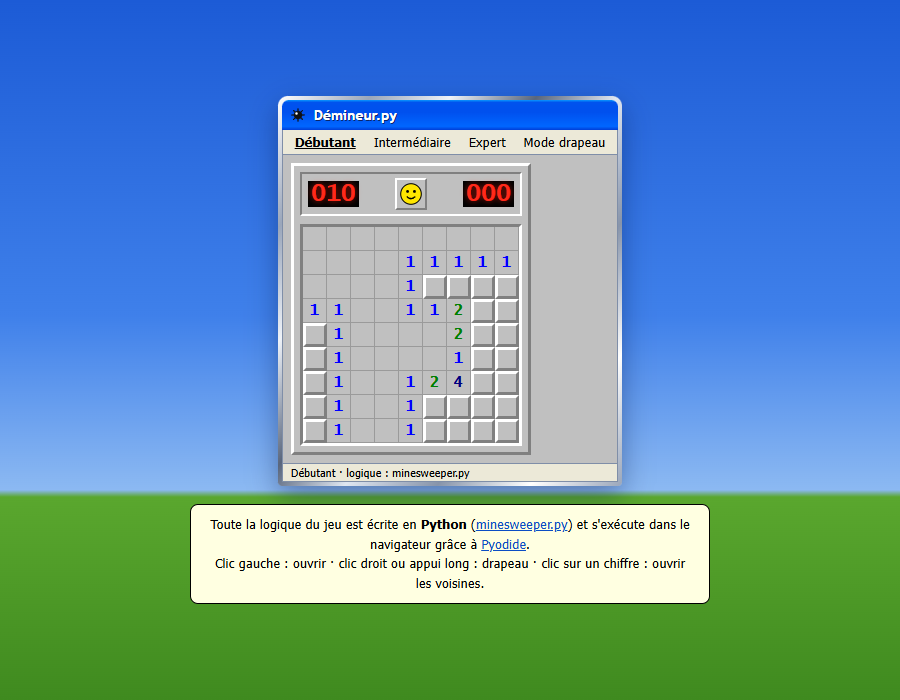

# Démineur.py

Un **Démineur codé en Python**, jouable de deux façons :

- **dans le navigateur**, avec une interface façon Windows XP : le même fichier Python tourne en WebAssembly grâce à [Pyodide](https://pyodide.org/) ;
- **dans un terminal**, avec `python minesweeper.py`.

👉 **Jouer en ligne : [vador634.github.io/Demineur_Python](https://vador634.github.io/Demineur_Python/)**



À l'origine, c'est l'easter egg caché de mon portfolio.

## Comment ça marche

Toute la logique du jeu est dans [`minesweeper.py`](minesweeper.py), une classe `Demineur` sans aucune dépendance :

| Méthode | Rôle |
|---|---|
| `ouvrir(l, c)` | Ouvre une case. Au premier clic, les mines sont placées en évitant la case et ses voisines, donc on ne perd jamais au premier coup. Les zones vides s'ouvrent en cascade. |
| `drapeau(l, c)` | Pose ou retire un drapeau. |
| `accord(l, c)` | Clic sur un chiffre : ouvre les voisines si le bon nombre de drapeaux est posé. |
| `etat()` | Renvoie le plateau en JSON (cases cachées, chiffres, drapeaux, mines en fin de partie). |

Côté navigateur, [`demineur.js`](demineur.js) :
1. charge Pyodide (l'interpréteur CPython compilé en WebAssembly) seulement quand on ouvre le jeu ;
2. écrit `minesweeper.py` dans le système de fichiers virtuel et l'importe comme un vrai module ;
3. appelle les méthodes Python à chaque clic, puis affiche l'état JSON renvoyé.

Le JavaScript ne gère que l'affichage, le chronomètre et les clics. Il ne contient aucune règle du jeu.

## Jouer

**Navigateur** : servir le dossier (la page doit être servie en HTTP pour charger `minesweeper.py`) :

```bash
python -m http.server 8000
# puis ouvrir http://localhost:8000
```

Trois niveaux : Débutant (9×9, 10 mines), Intermédiaire (16×16, 40 mines) et Expert (16×30, 99 mines). Le record de chaque niveau est mémorisé.
Clic gauche : ouvrir · clic droit ou appui long : drapeau · clic sur un chiffre : ouvrir les voisines · « Mode drapeau » sur mobile.

**Terminal** :

```bash
python minesweeper.py
```

Saisir `ligne colonne` pour ouvrir une case, ou ajouter `f` (ex. `3 4 f`) pour un drapeau.

## Tests

```bash
python -m unittest discover -s tests -v
```

Les tests vérifient notamment que le premier clic ne tombe jamais sur une mine (200 parties), la victoire, la défaite, les drapeaux, l'accord et le niveau expert.

## Auteur

**Kilian Carasco** — [Portfolio](https://kiliandev.netlify.app) · [GitHub](https://github.com/Vador634) · [LinkedIn](https://www.linkedin.com/in/kilian-carasco-029915399/)
